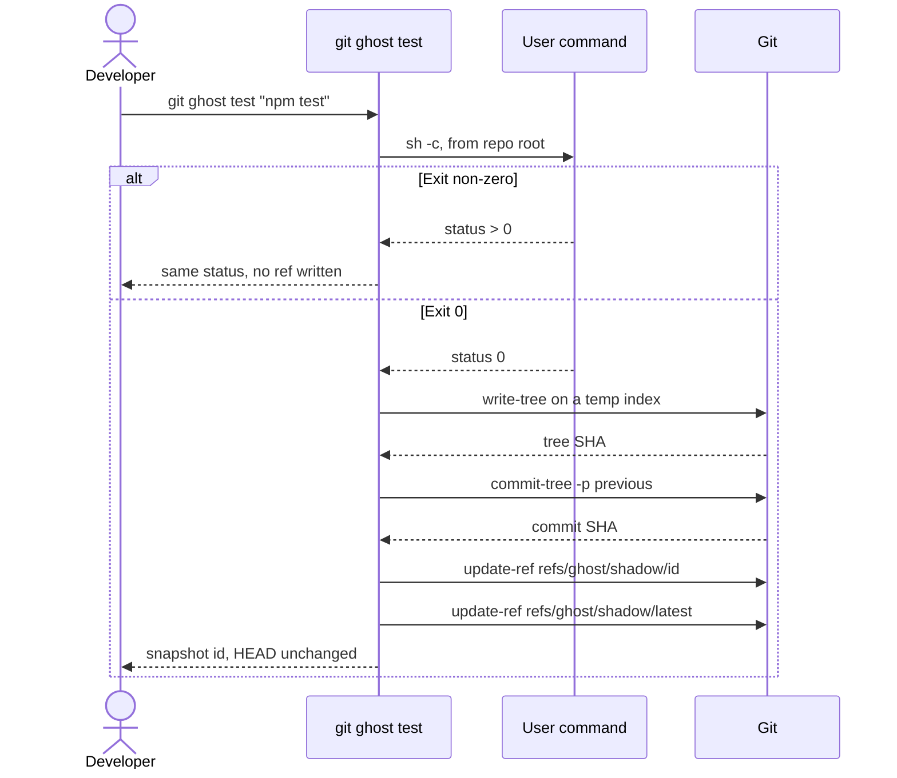
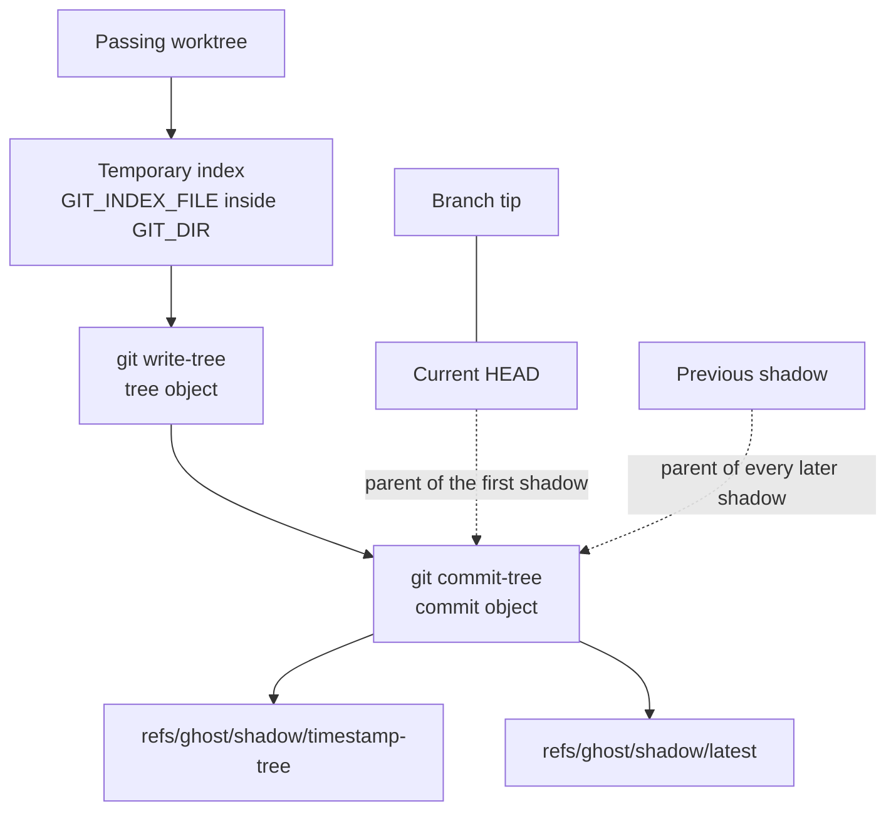
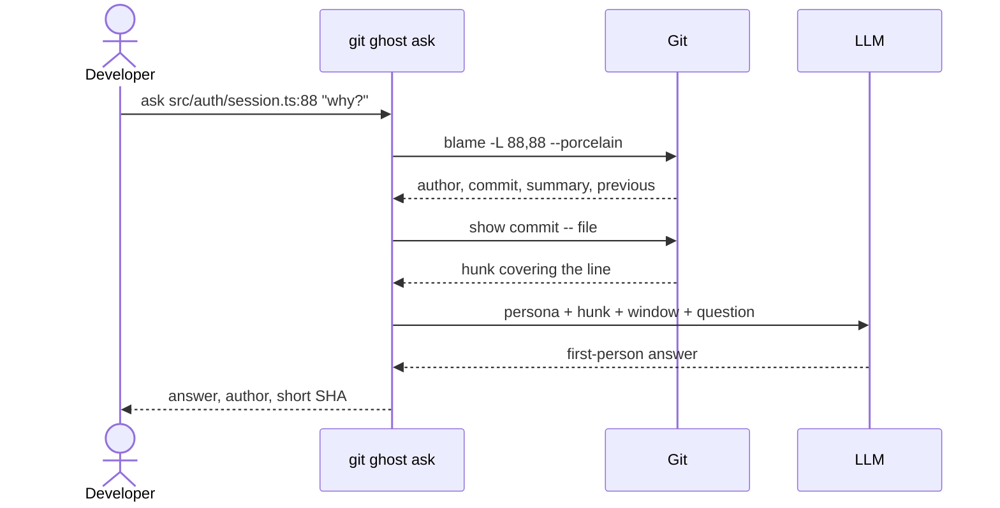

```
  ____ _ _      ____ _               _
 / ___(_) |_   / ___| |__   ___  ___| |_
| |  _| | __| | |  _| '_ \ / _ \/ __| __|
| |_| | | |_  | |_| | | | | (_) \__ \ |_
 \____|_|\__|  \____|_| |_|\___/|___/\__|
```

<p align="center">
  <strong>Talk to the commit that wrote the line.</strong><br>
  Rewind to the last test that passed.
</p>

<p align="center">
  <a href="https://nodejs.org/"></a>
  <a href="https://www.typescriptlang.org/"></a>
  <a href="https://git-scm.com/docs"></a>
  
  <a href="LICENSE"></a>
</p>

> **Git-Ghost** is a custom Git subcommand. It summons the author behind a line of code, and it remembers the last moment your tests passed — as a real Git object your branch history never has to carry.

> **Hackathon status.** This repository is the architecture contract. Scope A owns the CLI foundation, `git ghost ask`, and the dashboard skeleton. Scope B owns `git ghost test`, `git ghost rewind`, and the shadow-ref plumbing. The behavior on this page is the specification both sides implement. Source files are scaffolds with that ownership written in.

## Contents

- [The problem](#the-problem)
- [👻 Ghost Archaeology](#-ghost-archaeology)
- [🛡️ Shadow commits and rewind](#️-shadow-commits-and-rewind)
- [🖥️ Visual dashboard](#️-visual-dashboard)
- [Plumbing](#plumbing)
- [Layout and scope split](#layout-and-scope-split)
- [Module contract](#module-contract)
- [Command reference](#command-reference)
- [Quickstart](#quickstart)
- [Roadmap](#roadmap)
- [Safety contract](#safety-contract)

## The problem

Two failures show up in the same afternoon.

The suite went green at 16:10. You kept editing. At 16:40 it is red, and the green files are mixed with the red ones in one dirty worktree. `git stash` hides the mess and gives it a name you will forget. `git checkout .` throws the green moment away. There is no commit to return to, because you never stopped to make one. The work you are afraid of losing is exactly the work you have not committed yet.

The other failure is older than your branch. A function returns early for a reason that made sense to someone in 2023. `git blame` prints a name, a hash, and a date. The subject line says `fix`. The diff is eighty lines and three concerns. You can read all of it and still be unable to ask why *this* line exists.

Git-Ghost is built for those two moments.

| You have… | Git-Ghost gives you… |
| --- | --- |
| A line you do not understand | The author of that line, speaking from the commit that last touched it |
| A worktree that used to pass | A named snapshot of that passing tree, stored beside your branch |
| A red suite and a fading memory of green | `git ghost rewind` back to the last pass |
| A hash you do not want to paste into a chat window | A local dashboard with the same timeline and the same conversation |

## 👻 Ghost Archaeology

`git ghost ask <file>:<line> [question]`

Blame already knows who wrote the line. It does not know how to talk. Ghost Archaeology turns one blamed line into a conversation with the person who last changed it: their name, their commit, their diff, and the question you actually have.

```text
$ git ghost ask src/auth/session.ts:88 "why refresh before the expiry check?"
```

### What the command gathers

1. **Target.** `<file>:<line>` is a path relative to the repository root plus a 1-based line. The file must exist in the worktree. A binary file stops the command with a clear message.
2. **Blame chunk.** Ghost runs `git blame -L <line>,<line> --porcelain -- <file>` and reads the porcelain header: commit SHA, author, author mail, author time, summary, the filename at that commit, and `previous` when the line moved.
3. **Author diff.** `git show --format=fuller --unified=8 <sha> -- <filename>` supplies the commit. Ghost keeps the hunk that covers the blamed line, plus one neighboring hunk on each side, and trims the excerpt to `GHOST_MAX_DIFF_BYTES`.
4. **Local window.** `GHOST_BLAME_CONTEXT_LINES` (default 12) lines above and below the target travel with the prompt, so the model can see the check, the refresh, and the return together.
5. **One hop of ancestry.** When porcelain includes `previous`, Ghost fetches that single earlier location. The hop explains a moved or copied line. The walk stops there, so a question about one line cannot drag in the whole history of the file.
6. **Persona injection.** The provider is `openai` or `anthropic`, selected by `GHOST_LLM_PROVIDER`. The system prompt is the author persona. The user prompt is the hunk, the window, and the question.

### How the persona behaves

The model is instructed to:

- Speak in the first person as the author named by blame.
- Treat the commit summary, the date, and the file diff as the historical evidence.
- Quote the current line and describe the constraint it protects.
- Say, in plain language, when the diff does not record a reason — and then describe only what the change does.
- Close with the short SHA and the subject line, so you can run `git show` on the same commit.

An uncommitted line has porcelain SHA `0000000…`. Ghost reports that the line has no commit yet and skips the model call. A missing API key exits with usage guidance and sends nothing over the network.

Omit the question and the ghost still answers: it explains the line's job and the constraint the commit was protecting.

```text
  ghost · src/auth/session.ts:88
  author   Maya Chen  <maya@example.com>
  commit   a1c4e09   fix: refresh the session before comparing expiry
  when     14 Mar 2025

  Maya:
  The expiry check used the cached token. A request that arrived in
  the same millisecond the token died was rejected, and only then
  refreshed — the client saw a 401 for a session we could have saved.
  I moved the refresh above the comparison. The old order is in this
  commit on purpose, so the next edit would have to argue with it.

  — a1c4e09  fix: refresh the session before comparing expiry
```

The dashboard calls this same function. There is one ask engine, whether you typed the command or clicked a line.

## 🛡️ Shadow commits and rewind

`git ghost test [cmd]` · `git ghost rewind [selector]`

A shadow commit is a real commit object that your branch does not point at. Ghost creates one when a command you choose exits 0, and anchors it at `refs/ghost/shadow/*`. The passing tree gets a name. `HEAD` stays where you left it. Default `git log` keeps telling the story of the branch.

### `git ghost test`

```text
$ git ghost test "npm test"
```

With no command, Ghost runs the `test` script from the nearest `package.json`. With a command, Ghost runs it through `sh -c` from the repository root — the same tree the developer is looking at.

| Result | What Ghost writes |
| --- | --- |
| Exit 0 | A new immutable ref under `refs/ghost/shadow/`, and `refs/ghost/shadow/latest` moves to it |
| Exit non-zero | Nothing. Ghost exits with the command's own status code |
| Git plumbing failure | No new shadow ref. Exit 1 |

The snapshot includes the worktree that just passed, tracked changes and untracked files that Git would add. `git add` runs against a **temporary index** (`GIT_INDEX_FILE` pointed at a unique file inside `$GIT_DIR`). The developer's index is left alone. Ignored paths such as `node_modules/` stay out, because the temporary `git add -A` honors `.gitignore`.

```text
  ghost · running npm test
  ✓ 42 passed

  shadow snapshot
  tree     9f2a11c4e0b7
  commit   c0ffee12ab80
  ref      refs/ghost/shadow/20261101T150422Z-9f2a11c
  latest   refs/ghost/shadow/latest

  HEAD is still 4ab91d2. Branch history is unchanged.
```

### `git ghost rewind`

Rewind puts a passing tree back into the index and the worktree. The branch tip stays on the commit it already names. Afterward, `git status` shows the restored files relative to that tip, ready for an ordinary `git commit` when you decide the restoration belongs in history.

Zero-friction here means the safety step is automatic. Before the worktree changes, Ghost writes the current tree to `refs/ghost/backup/<timestamp>-<tree>`. If the checkout cannot finish, Ghost restores that backup and exits 3. `git ghost rewind --undo` returns to the newest backup.

```text
$ git ghost rewind

  ghost · backup  refs/ghost/backup/20261101T161510Z-44c0de1
  ghost · restore refs/ghost/shadow/20261101T150422Z-9f2a11c
  worktree matches the last passing snapshot
  branch main still points at 4ab91d2
```

Selectors:

| Selector | Resolves to |
| --- | --- |
| *(omitted)* | `refs/ghost/shadow/latest` |
| `2` | Two snapshots back along the shadow parent chain |
| `refs/ghost/shadow/<id>` | That exact ref |
| `--list` | A table of shadow refs. The worktree stays as it is |
| `--undo` | The newest `refs/ghost/backup/*` ref |

### Why the passing moment survives a crash

Each shadow commit stores, in its message, the facts the dashboard and a later rewind need:

```text
ghost: pass npm test

Branch: main
Head: 4ab91d2c88e14f0a1b2c3d4e5f60718293a4b5c6
Command: npm test
Exit: 0
```

The first shadow in a chain uses the current `HEAD` as its parent, so you can see which branch commit the green run sat on. The next shadow uses the previous shadow as its parent. The chain is a private timeline of passes. If `HEAD` is unborn, `commit-tree` records a root commit and the chain starts there.

`git commit-tree` writes the object directly. Branch hooks and `HEAD` updates stay on the normal `git commit` path, which Ghost leaves to you.

## 🖥️ Visual dashboard

`git ghost gui`

A local timeline for the same refs and the same ask engine. The process stays in the foreground, bound to `127.0.0.1` and `GHOST_GUI_PORT` (default `4737`). Ctrl+C shuts it down. A taken port exits 1 with the port number.

```text
$ git ghost gui

  ghost · dashboard  http://127.0.0.1:4737
```

| Surface | Behavior |
| --- | --- |
| Timeline | Every `refs/ghost/shadow/*` ref, newest first, with command, time, branch, and HEAD oid |
| Snapshot | The commit message, parent link, and tree. Rewind calls `rewind()` |
| Conversation | Pick a file and a line. The panel calls `ask()` and renders the persona with the SHA |
| Backup rail | `refs/ghost/backup/*`, including `--undo` |

The GUI reads the same refs and functions as the CLI. If a ref exists, the timeline can show it. If `git ghost ask` can answer, the panel can ask. Stack for the skeleton: a Node HTTP server in `src/gui/server.ts`, React views in `src/gui/web/main.tsx`, Tailwind utility classes on the markup. The Vite config arrives with the first rendered timeline.

```text
GET  /api/shadows          → listShadows()
POST /api/rewind           → rewind()
POST /api/ask              → ask()
GET  /                     → dashboard shell
```

## Plumbing

Shadow state is isolated with three Git plumbing commands and one private ref namespace. The branch is a spectator.

```text
  git ghost test "npm test"
            |
            v
     command exit code
        /         \
     fail          pass
      |             |
 write nothing      v
              temp index in $GIT_DIR
              (your index stays put)
                    |
                    v
              git write-tree
                    |
                    v
         git commit-tree <tree>
           -p <prev shadow | HEAD>
           -m "ghost: pass …"
                    |
                    v
    git update-ref refs/ghost/shadow/<id>
    git update-ref refs/ghost/shadow/latest
                    |
          +---------+---------+
          |                   |
     branch HEAD          git log
     unmoved              walks HEAD
                          branch story unchanged
```





The dotted arrows are parent pointers **inside** the shadow commit. Branch tips stay on the commits they already name. Git stores the object, `refs/ghost/` keeps it alive, and the branch pointer stays where it is.

### Rewind path

```text
  refs/ghost/shadow/latest -----> commit -----> tree
                                      |
  git ghost rewind                    |
                                      v
                    1. commit-tree of the current worktree
                       refs/ghost/backup/<id>
                                      |
                    2. git read-tree --reset -u <shadow tree>
                                      |
                    index + worktree match the snapshot
                    HEAD still names the branch tip
```

### What each command is for

| Plumbing | Role |
| --- | --- |
| `git write-tree` | Hash the temporary index into a tree object |
| `git commit-tree` | Wrap that tree in a commit with a parent and the structured message. `HEAD` stays put |
| `git update-ref` | Point `refs/ghost/shadow/*` or `refs/ghost/backup/*` at that commit |
| `git read-tree --reset -u` | Copy a chosen tree into the index and the worktree on rewind |
| `git for-each-ref` | List snapshots for the CLI and the dashboard |
| `git blame --porcelain` | Identify the author commit for `ask` |
| `git show` | Extract the author diff that the persona is allowed to use |
| `git rev-parse --show-toplevel` / `--git-path` | Find the worktree and `GIT_DIR`, including linked worktrees |

### Why `git log` stays readable

Default `git log` walks `HEAD`. A shadow commit is reachable from `refs/ghost/shadow/*`, so the history you read on the branch stays the history you wrote.

`git log --all` lists every ref under `refs/`, including `refs/ghost/`. That visibility is deliberate: `git gc` keeps objects a ref can name. Delete a shadow ref and the usual grace period applies; until then the passing tree remains rewindable.

`git push` sends the current branch. `refs/ghost/*` stays in the local repository unless someone adds an explicit refspec. Snapshots are a local safety net.

`git commit-tree` also needs a Git identity (`user.name`, `user.email`), the same requirement as an ordinary commit.

### Ask path



## Layout and scope split

```
# Scope A — core CLI, `git ghost ask`, architecture, GUI skeleton
# Scope B — `git ghost test`, `git ghost rewind`, shadow-ref plumbing

.
├── .env.example
├── .gitignore
├── LICENSE
├── README.md
├── package-lock.json
├── package.json
├── tsconfig.json
├── bin
│   └── git-ghost.ts                         # A  `git ghost` subcommand entry
├── src
│   ├── foundation                           # A  shared runtime
│   │   ├── config.ts                        # A  env + ref namespace
│   │   ├── errors.ts                        # A  exit codes
│   │   ├── git-exec.ts                      # A  the only Git spawner
│   │   ├── logger.ts                        # A  `ghost ·` stdout / stderr
│   │   └── repo.ts                          # A  toplevel, git dir, HEAD, branch
│   ├── cli
│   │   ├── context.ts                       # A  argv + RepoContext + config
│   │   ├── program.ts                       # A  dispatch: ask, test, rewind, gui
│   │   └── commands
│   │       ├── ask.ts                       # A  `git ghost ask` surface
│   │       ├── gui.ts                       # A  `git ghost gui` surface
│   │       ├── rewind.ts                    # B  `git ghost rewind` surface
│   │       └── test.ts                      # B  `git ghost test` surface
│   ├── ask                                  # A  Ghost Archaeology
│   │   ├── target.ts                        # A  parse <file>:<line>
│   │   ├── blame.ts                         # A  porcelain blame → chunk
│   │   ├── diff.ts                          # A  author diff extraction
│   │   ├── persona.ts                       # A  author persona
│   │   ├── prompt.ts                        # A  persona + hunk + question
│   │   └── llm.ts                           # A  provider injection
│   ├── gui                                  # A  visual dashboard skeleton
│   │   ├── server.ts                        # A  loopback HTTP server
│   │   ├── routes.ts                        # A  timeline + ask routes
│   │   └── web
│   │       ├── index.html                   # A  dashboard shell
│   │       └── main.tsx                     # A  timeline and conversation UI
│   └── shadow                                # B  shadow commits and rewind
│       ├── test-runner.ts                   # B  run the command, gate on exit 0
│       ├── snapshot.ts                      # B  pass → invisible snapshot
│       ├── rewind.ts                        # B  restore a shadow tree
│       ├── safety.ts                        # B  backup ref before any worktree edit
│       └── plumbing
│           ├── write-tree.ts                # B  temp index + `git write-tree`
│           ├── commit-tree.ts               # B  `git commit-tree`
│           └── refs.ts                      # B  `refs/ghost/shadow/*`
└── tests
    ├── ask                                  # A  blame fixtures, prompt assembly
    │   └── .gitkeep
    └── shadow                               # B  temp repos, ref updates, rewind
        └── .gitkeep
```

| Owner | Paths | Builds |
| --- | --- | --- |
| **Scope A** | `bin/`, `src/foundation/`, `src/cli/program.ts`, `src/cli/context.ts`, `src/cli/commands/ask.ts`, `src/cli/commands/gui.ts`, `src/ask/`, `src/gui/`, `tests/ask/` | The `git-ghost` subcommand, config, logging, repo discovery, the only `git` spawner, the ask engine, the dashboard skeleton |
| **Scope B** | `src/cli/commands/test.ts`, `src/cli/commands/rewind.ts`, `src/shadow/`, `tests/shadow/` | Test gating, temporary-index snapshots, `commit-tree` messages, `refs/ghost/*`, backup, rewind |

`program.ts` (Scope A) is the dispatcher. It calls Scope B through `runGhostTest`, `rewind`, and `listShadows`. Shadow modules call `runGit` from `src/foundation/git-exec.ts` for every Git invocation, including `write-tree`, `commit-tree`, and `update-ref`.

Git finds the subcommand by name. An executable called `git-ghost` on `PATH` makes `git ghost …` work. `npm link` puts that name on `PATH`.

## Module contract

Shared types, so the CLI, the dashboard, and the shadow engine pass one shape around:

```ts
export type RepoContext = {
  toplevel: string
  gitDir: string
  head: string | null
  branch: string | null
}

export type Snapshot = {
  ref: string
  commit: string
  tree: string
  parent: string | null
  branch: string | null
  head: string | null
  command: string
  createdAt: string
}

export type GhostAnswer = {
  file: string
  line: number
  authorName: string
  authorEmail: string
  commit: string
  summary: string
  answer: string
}
```

| Export | Module | Owner | Contract |
| --- | --- | --- | --- |
| `openRepo(cwd)` | `foundation/repo.ts` | A | `RepoContext`. `head` is null when `HEAD` is unborn. `branch` is null when detached |
| `runGit(args, options)` | `foundation/git-exec.ts` | A | Spawns `git` with optional `cwd` and `GIT_INDEX_FILE`. Returns stdout, stderr, and code |
| `loadConfig()` | `foundation/config.ts` | A | Reads the environment. `ask` refuses to run when the selected provider has no key or model |
| `ask(repo, target, question?)` | `src/ask/` | A | Returns `GhostAnswer`, or a typed error for uncommitted lines, binary files, and provider failures |
| `runGhostTest(repo, command)` | `shadow/test-runner.ts` | B | Exit 0 returns a `Snapshot` and updates `latest`. Any other status writes no shadow ref and passes the status through |
| `rewind(repo, selector?)` | `shadow/rewind.ts` | B | Writes a backup ref, then `read-tree --reset -u` of the selected shadow. `HEAD` stays put |
| `listShadows(repo)` | `shadow/refs.ts` | B | `for-each-ref` under the configured namespace |

Exit codes from `src/foundation/errors.ts`:

| Code | When |
| --- | --- |
| `0` | Ask, snapshot, rewind, list, or GUI startup succeeded |
| *command status* | `git ghost test` ran a failing command. No shadow ref was written |
| `2` | Usage: unknown command, bad `<file>:<line>`, missing provider key or model |
| `1` | Blame, the model, or Git plumbing failed |
| `3` | Rewind stopped before the worktree changed, or was rolled back to the backup it just wrote |

## Command reference

Transcripts are the interface. Engines implement this contract.

### Ask

```text
$ git ghost ask src/auth/session.ts:88 "why refresh before the expiry check?"

  ghost · src/auth/session.ts:88
  author   Maya Chen  <maya@example.com>
  commit   a1c4e09   fix: refresh the session before comparing expiry
  when     14 Mar 2025

  Maya:
  The expiry check used the cached token. A request that arrived in
  the same millisecond the token died was rejected, and only then
  refreshed. I moved the refresh above the comparison so that race
  would renew the session instead of failing it.

  — a1c4e09  fix: refresh the session before comparing expiry
```

```text
$ git ghost ask src/auth/session.ts:12

  ghost · src/auth/session.ts:12
  author   Maya Chen  <maya@example.com>
  commit   88b10ac   feat: add session refresh

  Maya:
  This guard rejects an empty token before we touch the clock.
  The commit does not record a deeper policy than that. The diff
  adds the check and returns 401.

  — 88b10ac  feat: add session refresh
```

### Test

```text
$ git ghost test "npm test"

  ghost · running npm test
  ✓ 42 passed

  shadow snapshot
  tree     9f2a11c4e0b7
  commit   c0ffee12ab80
  ref      refs/ghost/shadow/20261101T150422Z-9f2a11c
  latest   refs/ghost/shadow/latest

  HEAD is still 4ab91d2. Branch history is unchanged.
```

```text
$ git ghost test "npm test"

  ghost · running npm test
  ✗ 3 failed

  no snapshot written
  refs/ghost/shadow/latest unchanged
```

### Rewind

```text
$ git ghost rewind --list

  REF                                                  WHEN              COMMAND
  refs/ghost/shadow/20261101T161003Z-b7e04aa          16:10:03          npm test
  refs/ghost/shadow/20261101T150422Z-9f2a11c          15:04:22          npm test
```

```text
$ git ghost rewind

  ghost · backup  refs/ghost/backup/20261101T161510Z-44c0de1
  ghost · restore refs/ghost/shadow/20261101T161003Z-b7e04aa
  worktree matches the last passing snapshot
  branch main still points at 4ab91d2
```

```text
$ git ghost rewind 2

  ghost · backup  refs/ghost/backup/20261101T161640Z-91aa004
  ghost · restore refs/ghost/shadow/20261101T150422Z-9f2a11c
  worktree matches that snapshot
  branch main still points at 4ab91d2
```

```text
$ git ghost rewind --undo

  ghost · restore refs/ghost/backup/20261101T161640Z-91aa004
  worktree matches the pre-rewind backup
  branch main still points at 4ab91d2
```

### GUI

```text
$ git ghost gui

  ghost · dashboard  http://127.0.0.1:4737
```

### Help

```text
$ git ghost --help

  git ghost ask <file>:<line> [question]   ask the author of a line
  git ghost test [cmd]                     snapshot the tree when cmd passes
  git ghost rewind [selector]              restore a shadow snapshot
  git ghost gui                            open the local timeline

  selectors: latest (default) | <n> | refs/ghost/shadow/<id> | --list | --undo
```

## Quickstart

### Prerequisites

- Node.js 20 or newer
- Git 2.30 or newer
- A Git identity (`user.name` and `user.email`), required by `git commit-tree`
- An API key for OpenAI or Anthropic, required by `git ghost ask`

### Install

```bash
git clone https://github.com/1dcat/Git-Ghost.git
cd Git-Ghost
npm install
cp .env.example .env
```

Edit `.env`, then export the variables in your shell (or load the file however you already load secrets):

```bash
set -a
source .env
set +a
```

`.env` is gitignored. `.env.example` is the contract.

### Environment

| Variable | Required | Purpose |
| --- | --- | --- |
| `GHOST_LLM_PROVIDER` | for `ask` | `openai` or `anthropic` |
| `OPENAI_API_KEY` | provider `openai` | OpenAI credential |
| `OPENAI_MODEL` | provider `openai` | Model id for that account |
| `ANTHROPIC_API_KEY` | provider `anthropic` | Anthropic credential |
| `ANTHROPIC_MODEL` | provider `anthropic` | Model id for that account |
| `GHOST_REF_NAMESPACE` | no | Default `refs/ghost`. Scope B writes only beneath it |
| `GHOST_BLAME_CONTEXT_LINES` | no | Default `12` |
| `GHOST_MAX_DIFF_BYTES` | no | Default `24000` |
| `GHOST_GUI_HOST` | no | Default `127.0.0.1` |
| `GHOST_GUI_PORT` | no | Default `4737` |

### Link the subcommand

Git dispatches `git ghost` to an executable named `git-ghost` on `PATH`. From this repository:

```bash
npm link
git ghost --help
```

Run `npm link` again after the Scope A entrypoint build is in place. Check the scaffold with:

```bash
npm run typecheck
```

### First session, once the engines are in

```bash
git ghost test "npm test"
git ghost ask src/auth/session.ts:88 "why is this check first?"
git ghost gui
git ghost rewind
```

## Roadmap

The four commands above are the hackathon product. These are the next rooms in the same building.

| Horizon | Feature | What it feels like |
| --- | --- | --- |
| Next | **IDE inline ghost comments** | A gutter action on a line runs `ask` and anchors the persona beside that line in Cursor or VS Code. The citation is a click through to `git show` |
| Next | **PR ghost reviewers** | On a pull request, each changed hunk asks the author of the replaced lines whether the new side still honors the constraint in their commit. The comment quotes that commit |
| Next | **Multi-branch timeline** | The dashboard draws one graph of shadow chains. Every snapshot already stores branch name and `HEAD` oid, so a feature branch and `main` keep separate rewind stacks after a checkout |
| Later | **CI shadows** | A green CI job can write a shadow ref into a local namespace on a runner checkout, using the same `write-tree` / `commit-tree` path |
| Later | **Transcript cache** | Ask transcripts stored under `$GIT_DIR/ghost/transcripts`, outside the worktree, so a repeated question can show the previous answer next to a fresh one |

PR review and the IDE stay clients of `ask`. The multi-branch graph stays a client of `listShadows`. New surfaces reuse the engines in this tree.

## Safety contract

- Ghost writes refs only under `refs/ghost/` (or `GHOST_REF_NAMESPACE`).
- Ghost leaves `HEAD` and every branch tip where it found them.
- Ghost pushes nothing.
- A shadow ref is created when the tested command exits 0.
- Rewind writes a backup ref before it edits the worktree.
- Every answer names the commit it used.
- The dashboard binds to loopback and calls the same functions as the CLI.

## License

[MIT](LICENSE) © 2026 ido gal david and Git-Ghost contributors.
